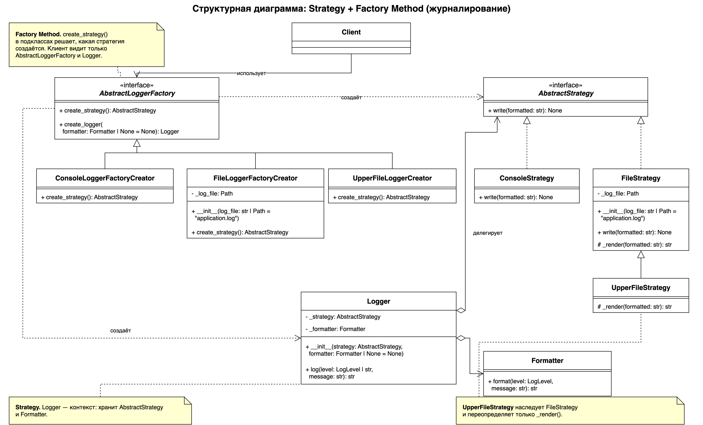

# Диаграммы

Исходники лежат рядом в формате draw.io (`architecture.drawio`), их можно открыть и поправить в draw.io.

## Strategy + Factory Method

Контекст `Logger`, интерфейс `AbstractStrategy` с тремя реализациями и `AbstractLoggerFactory` с тремя создателями.

